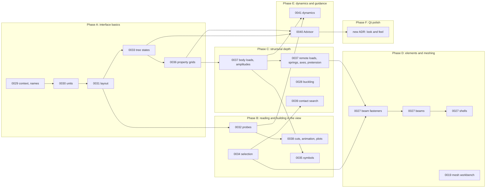

# Plan: from the Salome-Meca and PrePoMax review to a polished Puzzle

Written 2026-10-23. It sequences the 16 items of the review ("Puzzle against Salome-Meca and PrePoMax", a Claude Doc) through their ADRs. Each ADR is Proposed until the maintainer accepts it. A phase starts with acceptance of its ADRs, and each item ends with its tests and, for solver features, its benchmark (CLAUDE.md conventions).

## The 16 items and their ADRs

| Item | ADR | Size |
| --- | --- | --- |
| 1. Panels follow their context; no raw values | [0029](adr/0029-context-and-names.md) | S |
| 2. A unit system per project | [0030](adr/0030-project-unit-system.md) | S |
| 3. Docks, view toolbar, icon toolbar | [0031](adr/0031-workspace-layout.md) | S–M |
| 4. Extreme markers, probes, range in Properties | [0032](adr/0032-result-probes.md) | M |
| 5. Tree states | [0033](adr/0033-tree-status.md) | S–M |
| 6. Selection tools | [0034](adr/0034-selection-tools.md) | M |
| 7. Load and support symbols | [0035](adr/0035-load-symbols.md) | M |
| 8. Property-grid editors | [0036](adr/0036-property-grid-dialogs.md) | M |
| 9. Structural loads and constraints | [0037](adr/0037-structural-loads-and-constraints.md) | L |
| 10. Buckling | [0028](adr/0028-buckling.md) | M |
| 11. Beam fasteners, beams, shells | [0027](adr/0027-beams-shells-and-fasteners.md) | L |
| 12. Section cuts, animation, plots | [0038](adr/0038-results-cuts-animation-plots.md) | M |
| 13. Mesh workbench, Netgen, quality | [0019](adr/0019-mesh-workbench.md) | L |
| 14. Contact search | [0039](adr/0039-contact-search.md) | M |
| 15. Advisor | [0040](adr/0040-advisor.md) | M |
| 16. Structural dynamics | [0041](adr/0041-structural-dynamics.md) | L |

S is under a day, M a few days, L a week or more of focused work.

## Order and why

### Phase A: interface basics (0029, 0030, 0031, 0033, 0036), done 2026-10-23

- **Why first:** they are small, every session touches them, and later dialogs (loads, fatigue, dynamics) are built on 0036's form.
- **0029 first:** it fixes the two bugs the screenshots showed and adds the test that keeps the names rule.
- **Exit:** the screenshot set from the review, retaken, shows engineering units, a clear view toolbar, collapsed docks, tree states, and the fatigue dialog in a property grid.

### Phase B: reading and building in the view (0032, 0034, 0035, 0038), done 2026-10-23

- **0032 (probes) comes before 0038:** plots over steps read kept probes.
- **0034 (selection)** can run in parallel. Fasteners and contact search need its "same as" selection.
- **0035 (symbols)** draws today's features first, then gains glyphs as Phase C adds features.
- **Check before building:** VTK's hardware selector off screen (box select), 2D labels off screen on Retina, QtCharts and `imageio` in the pixi environments.

### Phase C: structural depth (0037, 0028, 0039), about four weeks

- **0037 in two halves:**
  - first body loads and amplitudes, which are solver-native on all four FE solvers and benchmarked by closed forms;
  - then remote loads, springs, local axes and pretension, CalculiX and Code_Aster first.
  - **Done (2026-10-24)** but for amplitudes on structural loads, which move to 0041. Body loads, remote loads, elastic supports and local axes run on all four FE solvers; rigid remote loads, bolt pretension and compression-only supports on CalculiX and Code_Aster.
- **0028 buckling** reuses the prestress replay already built for CalculiX. **Done (2026-10-24)** on CalculiX and Code_Aster: the preload is a static step before the buckling step, and the Euler column matches to 0.1 %.
- **0039 contact search** needs only OCC distance and the batch command. **Done (2026-10-24):** "Find contacts…" and MCP `contacts_find`. Phase C is complete.

### Phase D: elements and meshing (0027, 0019), about six weeks or more

- **0027 in its own order:** beam fasteners (line elements only), then beam line bodies, then shells. This is the biggest change to the mesh model and the result catalogue.
- **0019 comes first** (the maintainer's order): Netgen and quality first, which help everything. 0027 follows it.

### Phase E: dynamics and guidance (0041, 0040), about four weeks

- **0041 needs** amplitudes (0037), probes and plots (0032, 0038) for frequency responses, and modal studies as inputs.
- **0040 (Advisor) comes late on purpose:** it describes the workflow, so it waits until the tree states (0033), the form descriptions (0036) and the new features are settled.

### Phase F: Qt polish, downstream

A new ADR, written when Phase A is in use, chooses the look and feel. The options to evaluate:

- **Docking:** Qt Advanced Docking System (PySide6-QtAds, LGPL-2.1) for tabbed, floating and auto-hide docks, against Qt's own `QDockWidget` after 0031.
- **Theme:**
  - one palette and stylesheet (QSS) with light and dark variants;
  - spacing and typography tokens;
  - native-looking controls per platform where Qt's styles allow.
- **Icons:** finish the set started in 0031, with consistent sizes and states.
- **Overlays on the view:** Qt widgets over the off-screen `SceneView` (view toolbar, labels, legends) against VTK 2D actors. The constraint from CLAUDE.md stands: the view renders off screen, so overlays are Qt widgets.
- **Qt Quick (QML) for parts of the interface,** e.g. the Advisor or the start page, only if it doesn't fight the widgets-based main window.
- **Motion and feedback:** progress for long tasks, non-blocking toasts for finished runs.
- **Accessibility:** keyboard paths through the tree, properties and dialogs; colour-blind-safe states and colour maps.

## Answers so far (2026-10-23)

- **0030:** yes. A local switch per project turns on the project's own unit system, overriding the global setting. ADR 0030 is accepted with it.
- **0031:** the icon set is chosen later, with the Qt polish ADR (Phase F). Labels under icons or tooltips only is a setting; tooltips are always shown. ADR 0031 is accepted with it.
- **0037 and 0041:** their internal order doesn't matter. Both are needed before the first release, so they are release gates, not optional phases.

## Release gates

Every ADR here, 0019 and 0027 to 0041, is built before the first official release (the maintainer, 2026-10-23). Phase F's polish is planned for it too.

## Further answers (2026-10-23)

- **Phase D order:** the mesh workbench (0019) first, then beam fasteners, beams and shells (0027).
- **Phase A:** 0029, 0033 and 0036 are accepted as written.
